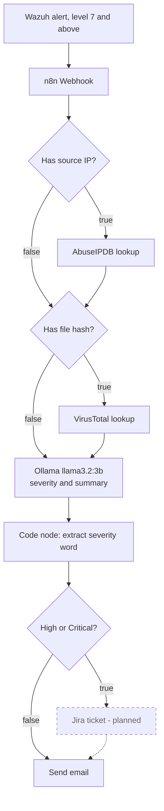

# AI-Enriched SOC Alert Pipeline

A self-hosted pipeline that takes a raw **Wazuh** SIEM alert, enriches it with live threat intelligence
(**AbuseIPDB**, **VirusTotal**), scores its severity with a **locally run language model** (**Ollama**),
and emails a plain-English verdict, before a human analyst opens the alert.

Everything runs on one machine, in Docker, on WSL2. There is no cloud dependency for the AI step.

> Built as a hands-on home lab to demonstrate SOC automation (SOAR) concepts: detection, enrichment,
> AI-assisted triage and notification, wired together end to end and tested against live-triggered
> attacks, not just sample data.

## Contents

- [What it does](#what-it-does)
- [Why a local model](#why-a-local-model-not-a-cloud-api)
- [Architecture](#architecture)
- [Stack and tested versions](#stack-and-tested-versions)
- [Requirements](#requirements)
- [Setup, step by step](#setup-step-by-step)
- [The n8n workflow, node by node](#the-n8n-workflow-node-by-node)
- [Alert payload contract](#alert-payload-contract)
- [Testing](#testing)
- [Day-to-day operations](#day-to-day-operations)
- [Troubleshooting](#troubleshooting)
- [Performance tuning on a small machine](#performance-tuning-on-a-small-machine)
- [Security notes](#security-notes)
- [Status and roadmap](#status-and-roadmap)
- [Lessons learned](#lessons-learned)

---

## What it does

Wazuh produces many alerts and most are routine. This pipeline takes the important ones (rule level 7 and
above) and adds the context an analyst would otherwise look up by hand:

1. **Is the source IP known to be abusive?** (AbuseIPDB)
2. **Is the changed file known to be malicious?** (VirusTotal)
3. **How serious is this overall?** A small local model reads the alert plus both lookups and returns one
   severity word (Low, Medium, High, Critical) and a two-sentence summary.
4. **Tell someone.** The result is emailed. High and Critical alerts are intended to also open a Jira
   ticket (planned, see [roadmap](#status-and-roadmap)).

Example verdict the model produced for a real test alert:

```
High

The alert triggered due to a test file alert from the book16 agent, which received a
VirusTotal score of 0 engines flagged as malicious out of 59 total. ...
```

That output is also an honest example of the current rough edge: the label says High while the reasoning
argues the opposite. See [Fixing severity calibration](#fixing-severity-calibration).

---

## Why a local model, not a cloud API

The pipeline was originally designed around a cloud LLM API and deliberately changed to a model served by
Ollama, for two reasons:

1. **Data sensitivity.** Every scored alert carries real source IPs, usernames and log lines. Sending that to
   an external API on every alert is an unnecessary exposure for a tool whose job is protecting the system.
2. **No per-call cost or AI rate limit.** Alert volume spikes unpredictably during an incident, which is
   when a cloud API's rate limit would hurt most. (AbuseIPDB and VirusTotal still have free-tier limits,
   which is one more reason for the level 7 filter.)

The trade-off, stated plainly: `llama3.2:3b` is small next to a frontier model, it runs on CPU only, and it
shows, both in some of its reasoning and in latency (seconds to a few minutes per alert on a laptop).
That is an accepted cost for keeping the data local.

---

## Architecture



Until the Jira node exists, **both** outputs of the severity check should go to the email node.

### How an alert moves

1. **Wazuh detects something**, for example a correlated SSH brute-force rule or a file-integrity (FIM)
   change. When the alert reaches level 7 or higher, `wazuh-integratord` runs a custom script that POSTs the
   alert JSON to an n8n webhook.
2. **n8n receives it** and starts the workflow.
3. **Check 1, source IP present?** True: call AbuseIPDB and continue. False: skip. Both paths rejoin.
4. **Check 2, file hash present?** True: call VirusTotal and continue. False: skip. Both paths rejoin.
5. **Ollama scores it.** The prompt includes the alert plus whichever enrichment ran. It references earlier
   nodes by name (for example `$('HTTP Request1')`) rather than a bare `$json`, so rewiring later does not
   silently break a reference.
6. **Severity check.** High or Critical goes to (planned) Jira. Everything goes to email.

---

## Stack and tested versions

| Layer | Tool | Role |
|---|---|---|
| Detection | **Wazuh 4.14.7** (manager, indexer, dashboard, native agent) | Agents collect logs and file-integrity data. The manager applies rules and runs the integration script. |
| Orchestration | **n8n 2.36.9** (self-hosted, Docker) | Node-based workflow engine. All branching and credentials live here. |
| IP reputation | **AbuseIPDB** | Called when an alert carries a source IP. |
| File reputation | **VirusTotal** | Called when an alert carries a file hash (syscheck alerts). |
| Severity scoring | **Ollama** with `llama3.2:3b` | Own container on its own Docker network, reached from n8n by container DNS. |
| Notification | **SMTP** (n8n Send Email node) | Delivers the verdict to an inbox. |
| Runtime | **Docker Desktop + WSL2 (Ubuntu)** | Container runtime and Linux layer. |

---

## Requirements

- Windows 10/11 with WSL2 and Docker Desktop (WSL integration enabled for your distro).
- **RAM:** this was built on a machine with about 9.7 GB total, giving WSL 7 GB. That works but is tight
  (Wazuh alone idles around 2.7 GB). 16 GB is far more comfortable. See
  [performance tuning](#performance-tuning-on-a-small-machine).
- **Disk:** plan for 40 GB or more. Docker's virtual disk grows and does not shrink on its own.
- Free accounts and keys: AbuseIPDB, VirusTotal, and an SMTP account (Gmail needs an app password).
- Use only on systems and networks you own or are authorised to test.

---

## Setup, step by step

All commands run in your WSL2 Ubuntu terminal unless noted.

### 1. Wazuh (single-node Docker deployment)

Use the official `wazuh-docker` repository, single-node folder, matching your Wazuh version.

```bash
cd ~/security-lab/wazuh-docker/single-node
docker compose -f generate-indexer-certs.yml run --rm generator   # one-time certificates
docker compose up -d
docker exec single-node-wazuh.manager-1 /var/ossec/bin/wazuh-control status
```

A `find: command not found` warning during certificate generation is harmless.
Wait about 20 seconds before checking status. `wazuh-db`, `wazuh-analysisd`, `wazuh-remoted` and
`wazuh-integratord` should say `running`. `wazuh-clusterd`, `wazuh-maild`, `wazuh-agentlessd` and
`wazuh-csyslogd` are disabled by default and say `not running`.

### 2. Wazuh agent (on the host)

```bash
curl -s https://packages.wazuh.com/key/GPG-KEY-WAZUH | sudo gpg --no-default-keyring \
  --keyring gnupg-ring:/usr/share/keyrings/wazuh.gpg --import
sudo chmod 644 /usr/share/keyrings/wazuh.gpg
echo "deb [signed-by=/usr/share/keyrings/wazuh.gpg] https://packages.wazuh.com/4.x/apt/ stable main" \
  | sudo tee /etc/apt/sources.list.d/wazuh.list
sudo apt update
sudo WAZUH_MANAGER='127.0.0.1' apt-get install wazuh-agent -y
sudo systemctl daemon-reload && sudo systemctl enable --now wazuh-agent
docker exec -it single-node-wazuh.manager-1 /var/ossec/bin/agent_control -l   # expect: Active
```

### 3. Ollama in its own container

```bash
docker network create ollama-net
docker run -d --name ollama --restart unless-stopped --network ollama-net \
  -p 11434:11434 -v ollama_models:/root/.ollama ollama/ollama
docker exec ollama ollama pull llama3.2:3b
```

Ollama has no login and no API key. It is an unauthenticated local API, which is why the n8n node needs no
credential.

### 4. n8n on the same network

```bash
docker volume create n8n_data
docker run -d --name n8n --restart unless-stopped --network ollama-net \
  -p 5678:5678 -v n8n_data:/home/node/.n8n docker.n8n.io/n8nio/n8n
docker exec -it n8n wget -qO- http://ollama:11434/api/tags      # should list llama3.2:3b
```

Always use the named volume. Without it, restarting the container loses every workflow and credential.
Before recreating the container, confirm the volume name with `docker inspect n8n --format '{{json .Mounts}}'`.

### 5. The Wazuh to n8n integration

Create `custom-webhook.sh`:

```bash
#!/bin/bash
# Wazuh custom integration: forward an alert to the n8n webhook
ALERT_FILE=$1
WEBHOOK_URL="http://host.docker.internal:5678/webhook/wazuh-alert"
curl -s -X POST -H "Content-Type: application/json" -d @${ALERT_FILE} ${WEBHOOK_URL} \
  >> /var/ossec/logs/integrations.log 2>&1
```

Install it into the manager container:

```bash
docker cp custom-webhook.sh single-node-wazuh.manager-1:/var/ossec/integrations/custom-webhook.sh
docker exec -u root single-node-wazuh.manager-1 chmod 750 /var/ossec/integrations/custom-webhook.sh
docker exec -u root single-node-wazuh.manager-1 chown root:wazuh /var/ossec/integrations/custom-webhook.sh
```

Add this block to `/var/ossec/etc/ossec.conf`, inside an `<ossec_config>` section, using the
[safe config change routine](#safe-config-change-routine):

```xml
<integration>
  <name>custom-webhook.sh</name>
  <hook_url>http://host.docker.internal:5678/webhook/wazuh-alert</hook_url>
  <level>7</level>
  <alert_format>json</alert_format>
</integration>
```

Rules that matter:

- `<name>` must match a real file in `/var/ossec/integrations/` exactly, otherwise the log says
  `File not found inside 'integrations'`.
- The script must be owned by `root:wazuh` with mode `750`.
- The manager runs in a container, so it cannot use `localhost` to reach n8n. `host.docker.internal` worked
  here. A more robust, untested alternative is putting the manager and n8n on one shared Docker network and
  calling `http://n8n:5678/...`.
- Both the script and the `ossec.conf` change live inside Docker volumes. **`docker compose down -v` erases
  them**, so re-apply both after any volume wipe.
- Confirm it loaded:
  ```bash
  docker exec single-node-wazuh.manager-1 grep -i integratord /var/ossec/logs/ossec.log | tail
  # want: Enabling integration for: 'custom-webhook.sh'   with no error after it
  ```

### 6. Build the n8n workflow

See the next section. Then click **Publish**. The production webhook only runs the published version.

### 7. Email (Gmail example)

| Setting | Value |
|---|---|
| Host | `smtp.gmail.com` |
| Port | `465` |
| SSL/TLS | on |
| User | your Gmail address |
| Password | a Google **app password** (needs 2-Step Verification). A normal account password is rejected. |

Port 587 failed with this node's single SSL toggle in both positions (`wrong version number` with it on,
`Must issue a STARTTLS command first` with it off). Port 465 with SSL on worked.

---

## The n8n workflow, node by node

| # | Node | Type | Purpose and key settings |
|---|---|---|---|
| 1 | **Webhook** | Webhook | POST, path `wazuh-alert`. The alert arrives under `body`. |
| 2 | **If1** | If | Condition: `{{ $json.body.data.srcip }}` **is not empty**. True: AbuseIPDB. False: If2. |
| 3 | **AbuseIPDB** (HTTP Request1) | HTTP Request | GET `https://api.abuseipdb.com/api/v2/check`, query `ipAddress` and `maxAgeInDays=90`, header `Key`. Always continues to If2. |
| 4 | **If2** | If | Condition: `{{ $json.body.syscheck.sha256_after }}` **is not empty**. True: VirusTotal. False: Ollama. |
| 5 | **VirusTotal** (HTTP Request2) | HTTP Request | GET `https://www.virustotal.com/api/v3/files/{hash}`, header `x-apikey`. |
| 6 | **Ollama** (HTTP Request) | HTTP Request | POST `http://ollama:11434/api/generate`, JSON body with `model`, `prompt`, `stream:false`. |
| 7 | **Code in JavaScript** | Code | Extracts the severity word from Ollama's response. |
| 8 | **If3 Severity Check** | If | `severity` equals `High` **OR** equals `Critical`. Convert types ON. |
| 9 | **Send an Email** | Send Email | Subject and body built from the severity and Ollama's summary. |

### Settings that caused real bugs

- **Convert types where required: ON for every If node.** With it off, a missing field is `undefined` and the
  "is not empty" check wrongly returned true. VirusTotal then fired on alerts that had no hash.
- **If3 true must go forward, not back.** Wiring its true output into the Code node creates a loop.
- **Match the case exactly.** A condition value of `higher` instead of `High` meant High alerts never matched.
- **If2 and the VirusTotal URL use `$json`.** On the AbuseIPDB path `$json` is AbuseIPDB's response, not the
  original alert. For robustness read `$('Webhook').item.json.body...` explicitly.
- **VirusTotal returns HTTP 404 for a hash it has never seen**, which stops the workflow. Consider setting
  enrichment nodes to continue on error so an unknown file cannot block the alert email.

### The Ollama prompt

```
You are a SOC analyst assistant. Analyze this security alert and respond in EXACTLY this format:
a one-word severity rating (Low/Medium/High/Critical), followed by a 2-sentence summary.

Alert details:
- Rule: {{ $('Webhook').item.json.body.rule_description }}
- Severity level: {{ $('Webhook').item.json.body.level }}
- Agent: {{ $('Webhook').item.json.body.agent_name }}
- Log detail: {{ $('Webhook').item.json.body.full_log || 'not available' }}
- {{ $('HTTP Request1').isExecuted ? 'IP reputation: ' + $('HTTP Request1').item.json.data.abuseConfidenceScore + '% abuse confidence (' + $('HTTP Request1').item.json.data.totalReports + ' reports)' : 'No IP reputation data available.' }}
- {{ $('HTTP Request2').isExecuted ? 'File reputation (VirusTotal): ' + $('HTTP Request2').item.json.data.attributes.last_analysis_stats.malicious + ' engines flagged this file as malicious out of ' + ($('HTTP Request2').item.json.data.attributes.last_analysis_stats.malicious + $('HTTP Request2').item.json.data.attributes.last_analysis_stats.undetected + $('HTTP Request2').item.json.data.attributes.last_analysis_stats.harmless) + ' total.' : 'No file reputation data available for this alert.' }}

Respond with ONLY the severity rating and 2-sentence summary. Do not provide general advice or unrelated information.
```

The `isExecuted` checks make the prompt work whichever branch the alert took. Renaming the HTTP Request nodes to
`AbuseIPDB`, `VirusTotal` and `Ollama` makes the expressions much easier to read. n8n updates references on
rename, but re-test afterwards.

### A more forgiving severity extractor

The simple "first word" approach breaks if the model writes `**High**` or `Severity: High`.

```javascript
const response = $input.item.json.response || '';
const m = response.match(/\b(Low|Medium|High|Critical)\b/i);
const severity = m ? m[1][0].toUpperCase() + m[1].slice(1).toLowerCase() : 'Unknown';
return { json: { ...$input.item.json, severity } };
```

### Email content

- Subject: `={{ 'Wazuh Alert: ' + $json.severity + ' - ' + $('Webhook').item.json.body.rule_description }}`
- Body: `={{ $json.response }}`

### Fixing severity calibration

In testing, the model rated a file with 0 of 59 detections as High while its own text said the alert was
probably not a threat. It anchors on Wazuh's raw level and then contradicts its own analysis. Add explicit
rules to the end of the prompt:

```
Severity rules:
- If VirusTotal shows 0 malicious detections and no IP reputation data indicates abuse,
  the severity must be Low or Medium, never High or Critical.
- Your severity word must agree with your own summary. Do not contradict your analysis.
```

This matters more once Jira is live, because a wrong label becomes a ticket someone has to dismiss.

---

## Alert payload contract

The workflow expressions read these fields from the webhook body:

| Field read by the workflow | Meaning |
|---|---|
| `body.rule_id` | Wazuh rule ID |
| `body.level` | Wazuh rule level |
| `body.rule_description` | Rule description |
| `body.agent_name` | Agent that raised the alert |
| `body.full_log` | Raw log line |
| `body.data.srcip` | Source IP (drives the AbuseIPDB branch) |
| `body.syscheck.sha256_after` | File hash (drives the VirusTotal branch) |

Raw Wazuh alert JSON nests several of these. **If your integration script forwards the raw alert**, map the
nested fields, either by adding an Edit Fields node right after the Webhook, or by changing the expressions:

| Workflow field | Raw Wazuh path |
|---|---|
| `rule_id` | `rule.id` |
| `level` | `rule.level` |
| `rule_description` | `rule.description` |
| `agent_name` | `agent.name` |
| `full_log`, `data.srcip`, `syscheck.sha256_after` | same path |

To find out which shape you are actually receiving, open a saved execution from a real alert, click the Webhook
node and read its output.

---

## Testing

### Trigger a real detection

```bash
# Only run this against a machine you own.
for i in $(seq 1 10); do
  ssh -o BatchMode=yes -o ConnectTimeout=2 baduser@localhost
done
```

Wazuh correlates the repeated failures into one escalated alert (rule `5712`, level 10, "brute force trying to
get access to the system") instead of the individual level 5 failed-login events. Individual failed logins fire
at level 5 and will not reach the pipeline.

### Send a synthetic alert

```bash
curl -X POST http://localhost:5678/webhook/wazuh-alert -H "Content-Type: application/json" \
  -d '{"rule_id":"5712","level":10,"rule_description":"manual test alert","agent_name":"book16",
       "full_log":"sshd: Failed password for invalid user test","data":{"srcip":"203.0.113.10"}}'
```

For the file-hash branch, add `"syscheck":{"sha256_after":"e3b0c44298fc1c149afbf4c8996fb92427ae41e4649b934ca495991b7852b855"}`
(the SHA-256 of an empty file).

### Test URL versus production URL

| URL | Behaviour |
|---|---|
| `/webhook-test/wazuh-alert` | Works once, and only after you click **Listen for test event** in the editor. |
| `/webhook/wazuh-alert` | Always live once the workflow is **Published**. Wazuh must use this one. |

`{"message":"Workflow was started"}` only means n8n accepted the request. Check the **Executions** tab to see
whether every node succeeded.

### Re-run without curl

Click the Webhook node, listen for one test event, send one alert, then click the **pin** icon on its output.
**Execute workflow** now replays that pinned alert. Pinned data only affects editor runs, never production.

### Prove the integration end to end by lowering the threshold

```bash
docker exec single-node-wazuh.manager-1 sed -i 's#<level>7</level>#<level>3</level>#' /var/ossec/etc/ossec.conf
docker exec -u root single-node-wazuh.manager-1 /var/ossec/bin/wazuh-control restart
# watch n8n Executions for a minute, then restore:
docker exec single-node-wazuh.manager-1 sed -i 's#<level>3</level>#<level>7</level>#' /var/ossec/etc/ossec.conf
docker exec -u root single-node-wazuh.manager-1 /var/ossec/bin/wazuh-control restart
```

---

## Day-to-day operations

```bash
# Start, check, stop Wazuh (stop keeps your data)
cd ~/security-lab/wazuh-docker/single-node
docker compose up -d
docker compose ps
docker exec single-node-wazuh.manager-1 /var/ossec/bin/wazuh-control status
docker compose stop

# Other services
docker ps --filter "name=n8n" --filter "name=ollama"
sudo systemctl status wazuh-agent
```

**Never run `docker compose down -v` unless you intend to wipe all Wazuh data.** It deletes the volumes. You
would have to regenerate nothing but re-copy the integration script, re-apply the `ossec.conf` change and
re-register the agent.

### Safe config change routine

This is the routine that finally worked after a long outage. Do not iterate edits against a live container.

1. Copy the current config out: `docker cp single-node-wazuh.manager-1:/var/ossec/etc/ossec.conf ./ossec.conf.edit`
2. Edit the copy on the host. Keep a backup of the last known-good file.
3. Copy it to `/tmp` in the container and validate with Wazuh's own tool, continuing only on exit code 0:
   ```bash
   docker cp ossec.conf.edit single-node-wazuh.manager-1:/tmp/ossec.conf.test
   docker exec single-node-wazuh.manager-1 /var/ossec/bin/wazuh-analysisd -t -c /tmp/ossec.conf.test; echo "exit: $?"
   ```
4. Copy it over `/var/ossec/etc/ossec.conf`, restart **once**, wait about 20 seconds, check `wazuh-control status`.

Do not validate with `xmllint`. Wazuh's default `ossec.conf` legitimately has two top-level `<ossec_config>`
blocks, which `xmllint` rejects as invalid XML even though Wazuh accepts it.

---

## Troubleshooting

| Symptom | Likely cause | Fix |
|---|---|---|
| `wazuh-db did not start correctly` and `(1226) Error reading XML file 'etc/ossec.conf'` | Never fully explained here. Config passed `wazuh-analysisd -t`, the same file behaved differently over time, restarts did not help. | Clean rebuild: `docker compose down -v`, bring the stack up, confirm a healthy baseline, then apply the finished config once. |
| `Unable to enable integration ... File not found inside 'integrations'` | `<name>` does not match the script filename, or the script was wiped with the volumes. | Match the name exactly and re-copy the script. |
| n8n `ECONNREFUSED` to Ollama | n8n and Ollama are not on the same Docker network, or the URL points at the host. | Put both on `ollama-net` and use `http://ollama:11434`. |
| Container cannot reach a service running in the Ubuntu distro | Docker Desktop runs containers in its own VM, separate from your WSL distro. `host.docker.internal`, `--add-host` and `--net=host` did not fix it. | Run the service as a container on a shared network. |
| `curl` to the test webhook says "not registered" | The test URL is single-use and expired. | Click **Listen for test event** again, or use the production URL on a Published workflow. |
| Webhook says "not registered for GET requests" | The URL was opened in a browser. | Send a POST with curl. |
| An If node takes the wrong branch | Missing field is `undefined` and type conversion is off. | Turn **Convert types where required** on. |
| Execution stops at VirusTotal with 404 | VirusTotal has never seen that hash. | Set the node to continue on error and guard the prompt expression. |
| Gmail: `wrong version number` or `Must issue a STARTTLS command first` | Port 587 with this node's SSL toggle. | Use port 465 with SSL on. |
| Gmail: `535 Username and Password not accepted` | Normal account password used. | Create a Google app password. |
| Dashboard (443) or agent (1514) not reachable though containers are `Up` | Docker Desktop's backend kept stale port bindings after repeated recreates. | Quit Docker Desktop fully, restart it, then `docker compose up -d --force-recreate`. |
| `docker: command not found` after `wsl --shutdown` | Docker's WSL integration toggle reset. | Docker Desktop, Settings, Resources, WSL Integration, enable your distro. |
| `Bus error` from every `docker` command | The Docker CLI shim lost its backend. | Restart Docker Desktop and re-check the WSL integration toggle. |
| Suricata crash-looping | Configured for a network interface that does not exist under WSL2. | `sudo systemctl disable --now suricata`. It cannot do useful capture in WSL2. |
| Windows C: drive almost full | Docker's `docker_data.vhdx` grew far beyond its used data. | Shut down Docker and WSL, then compact the file with `diskpart` (freed about 70 GB here). |
| Root filesystem became read-only | An abrupt `wsl --shutdown` triggered ext4's protection. | Clean restart so the journal replays. Avoid shutdowns with a nearly full disk. |
| Rotating the indexer password broke manager to indexer auth | The password was hardcoded in several consumers. | Update every consumer: indexer `internal_users.yml`, the manager's indexer settings and the dashboard config, then push the security config. |
| Laptop freezes when alerts arrive | Ollama saturates CPU and memory on a small machine. | See [performance tuning](#performance-tuning-on-a-small-machine). |

---

## Performance tuning on a small machine

Ollama on CPU can use every core, which freezes a laptop. Mitigations, lightest first:

```bash
# Cap the container (takes effect immediately)
docker update --cpus 4 --memory 4g --memory-swap 4g ollama
```

In the Ollama HTTP Request node, add body parameters to shorten and lighten each request:

| Name | Value | Effect |
|---|---|---|
| `options` | `{ "num_thread": 4, "num_predict": 120, "num_ctx": 2048 }` | Fewer cores, short answers, smaller memory reservation. |
| `keep_alive` | `30s` | Unload the model between alerts to free 2 to 3 GB. |

Cap the WSL VM in `C:\Users\<you>\.wslconfig`, then run `wsl --shutdown` and restart Docker Desktop:

```ini
[wsl2]
memory=7GB
processors=6
```

Never set `memory` above your real RAM. A 10 GB setting on a 9.7 GB machine caused intermittent instability.

Reduce how often the model runs: only send level 10 and above to the AI step, and send routine events
(package updates and similar) straight to a short email with no model call.

---

## Security notes

- **No API keys, SMTP credentials or live workflow exports belong in this repo.** n8n stores keys inline in
  node parameters, so a raw workflow export always carries live keys. This was learned the hard way (twice),
  and every exposed key was revoked and regenerated.
- Store keys in **n8n Credentials** (for example Header Auth) rather than typing them into node headers.
- Before sharing any export, screenshot or terminal output, scan it for keys, tokens and passwords.
- The webhook has **no authentication**. That is acceptable on a local lab. Add a header token before
  exposing port 5678 beyond the machine.
- Change the default Wazuh indexer admin password. Treat rotation as a multi-file change (see troubleshooting).
- Do not commit the certificate directory, cluster key or any `.env` files. A starter `.gitignore`:

```gitignore
# Wazuh certificates, keys and secrets
single-node/config/wazuh_indexer_ssl_certs/
*.pem
*.key
.env
# local scratch copies of configs
ossec.conf.*
# raw workflow exports may contain live API keys
n8n/*.json
!n8n/workflow.sanitized.json
```

Commit a workflow export only after clearing every credential value from it.

---

## Status and roadmap

**Working and verified with live-triggered alerts**

- [x] Wazuh detection, custom integration script and n8n webhook
- [x] AbuseIPDB enrichment (true and false paths)
- [x] VirusTotal enrichment (true and false paths)
- [x] Ollama severity scoring, container to container
- [x] SMTP delivery (Gmail, app password, port 465)

**Open**

- [ ] Confirm the alert payload shape and map nested Wazuh fields if needed
- [ ] Wire the email subject and body to the real severity and summary
- [ ] Confirm If3 sends both outputs to the email node and that its High condition reads exactly `High`
- [ ] Fix severity calibration in the prompt
- [ ] Move API keys into n8n Credentials
- [ ] Jira ticket creation on High or Critical (Jira Cloud, API-token auth)
- [ ] Alert classification table: map rule IDs or groups to categories, with a short no-AI email path for
      routine events such as package updates
- [ ] Optional: webhook authentication, continue-on-error for enrichment nodes, bind-mount the integration
      script so it survives a volume wipe

---

## Lessons learned

Most of the build time went into infrastructure, not workflow design.

- **Prepare, validate, apply once.** Repeated live edits and restarts against one container accumulated a bad
  state that a single clean application avoided.
- **Use the right validator.** `wazuh-analysisd -t -c` understands Wazuh's config. `xmllint` does not.
- **Know what lives where.** The indexer's `internal_users.yml` is a host bind mount and survived `down -v`.
  The integration script and `ossec.conf` live in volumes and did not.
- **Docker Desktop on WSL2 is a separate VM.** Anything that must talk to a container is best run as a
  container on a shared network.
- **Check disk and RAM first.** A nearly full C: drive and an over-large `.wslconfig` caused several strange,
  intermittent failures.
- **Rotating a credential means finding every consumer of it**, not just the source.
- **Verify, do not assume.** "Up" does not mean healthy, `{"message":"Workflow was started"}` does not mean
  success, and a green node does not mean the right branch ran.
- **Keep secrets out of anything you share.** Mask or crop them, and rotate immediately if one leaks.

---

## License

Choose a license before publishing (MIT is common for lab projects) and add a `LICENSE` file.
# ai-soc-pipeline
